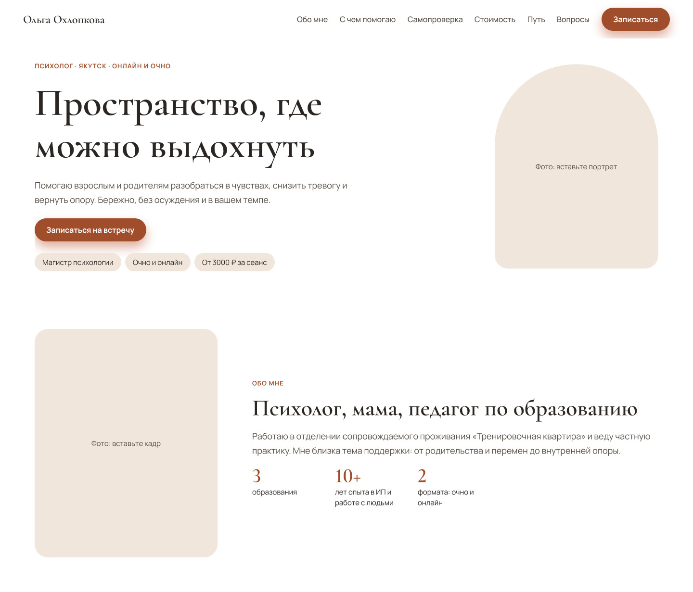
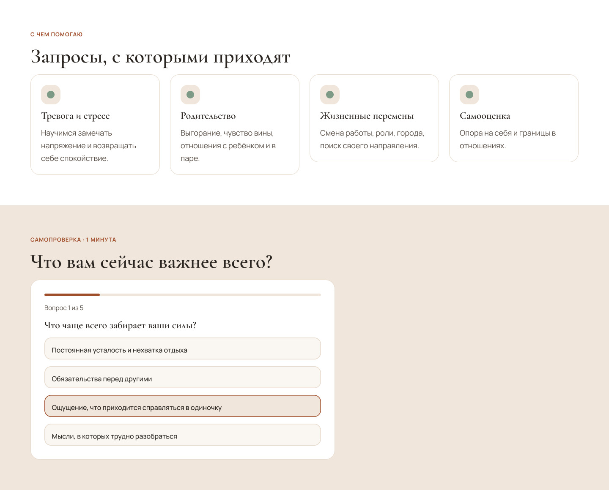

<div align="center">

# Ольга Охлопкова — психолог в Якутске

**Личный бренд-сайт: спокойный, быстрый и доступный**

[**Открыть сайт →**](https://steelykt.github.io/psychologist-site/)

`HTML` · `CSS` · `JavaScript` · `Figma` · `GitHub Pages`

</div>

---

## О проекте

Одностраничный сайт для практикующего психолога. Задача: вызвать доверие у человека, который приходит с тревогой, и мягко довести его до записи на консультацию.

Проект сделан как **учебно-практический кейс UX/UI-дизайна**: от идеи и дизайн-системы до публикации и доработок по обратной связи.

## Что внутри

| Блок | Зачем |
|---|---|
| Первый экран с дыхательным упражнением | Сразу снижает напряжение и показывает подход специалиста |
| Самопроверка из 5 вопросов | Вовлекает и подводит к записи. Ответы нигде не сохраняются |
| «Как проходит работа» | Снимает страх перед первым обращением |
| Стоимость | Прозрачная цена: от 3000 ₽ за сеанс |
| Принципы работы | Конфиденциальность, отсутствие осуждения, уважение к границам |
| Путь: образование и опыт | Профессиональное доверие |
| Частые вопросы | Закрывают возражения |
| Закреплённая панель связи на телефоне | Telegram и WhatsApp всегда под рукой |

## Дизайн-решения

- **Тон.** Тёплая палитра (песочный, терракотовый, шалфейный), шрифты Cormorant Garamond и Manrope с кириллицей.
- **Дыхание по желанию.** Упражнение запускается кнопкой, а не само: постоянная анимация раздражает тревожных пользователей. Ритм 4–2–6, длинный выдох успокаивает лучше.
- **Одно главное действие.** На первом экране один призыв «Записаться», остальное вторично.
- **Дизайн-токены.** Цвета, отступы и радиусы заданы переменными CSS и совпадают с переменными в Figma.
- **Светлая и тёмная тема.** Следует системной настройке, можно переключить вручную, выбор запоминается.

## Доступность

- Размер основного текста 18 px, расчётный контраст не ниже 4,5:1.
- Видимый фокус, зоны нажатия от 44 px, ссылка «К содержимому» для клавиатуры.
- `prefers-reduced-motion`: анимации отключаются.
- Семантическая разметка, подписи для кнопок, `aria-live` для упражнения и теста.
- Учтены безопасные зоны телефонов (`safe-area`).

## Дизайн-система в Figma

Файл содержит переменные (цвета светлой и тёмной тем, отступы, радиусы), стили текста и компоненты: кнопка с состояниями, карточка, плашка, вариант ответа, пункт FAQ. Макеты Desktop 1440 и Mobile 390 собраны на Auto Layout.

[Открыть файл Figma](https://www.figma.com/design/rBBQM9mYrRHQXFyUHTjyfq)

## Скриншоты

<div style="display: flex; gap: 15px; justify-content: flex-start; margin-bottom: 15px;">
  
  
</div>
<div style="display: flex; gap: 15px; justify-content: flex-start; margin-bottom: 15px;">
  
  
</div>

## Структура репозитория

```
psychologist-site/
├── index.html              # разметка страницы
├── assets/
│   ├── css/styles.css      # стили и дизайн-токены (:root)
│   ├── js/main.js          # тема, дыхание, самопроверка, меню
│   └── img/                # портреты и картинка для превью ссылки
├── docs/
│   ├── CONTENT.md          # тексты, цены, контакты: где что менять
│   ├── DESIGN.md           # цвета, шрифты, компоненты, доступность
│   ├── HANDOVER.md         # передача заказчику, публикация, чек-лист запуска
│   └── screenshots/        # скриншоты для README
├── CHANGELOG.md            # история версий
├── robots.txt
├── sitemap.xml
├── .nojekyll
└── README.md
```

Подробности: [контент](docs/CONTENT.md) · [дизайн](docs/DESIGN.md) · [передача заказчику](docs/HANDOVER.md) · [история версий](CHANGELOG.md).

## Планы

- [ ] Отзывы клиентов (после получения согласия)
- [ ] Данные исполнителя и политика конфиденциальности
- [ ] Номер местной службы экстренной психологической помощи
- [ ] Подключение домена и Яндекс Метрики
- [ ] Юзабилити-тесты с 3–5 людьми и правки по результатам
- [ ] Блог для поискового трафика

## Права

Тексты и фотографии принадлежат их владельцам и не предназначены для повторного использования без согласия. Код и структуру можно использовать как пример.
